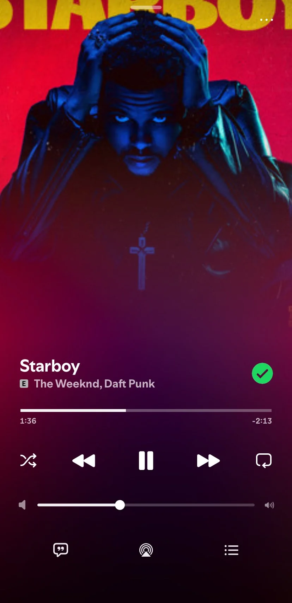
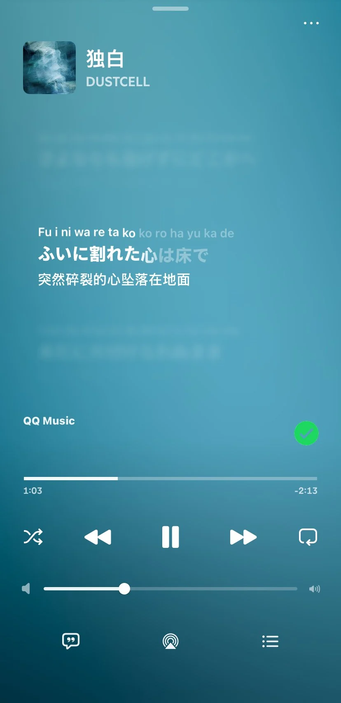
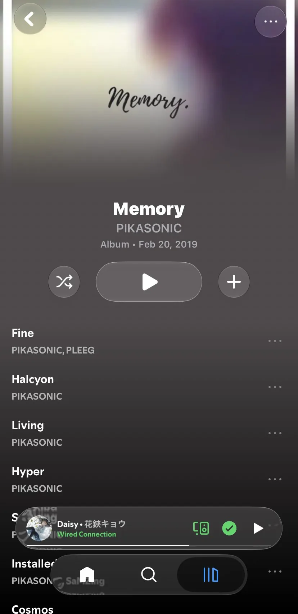
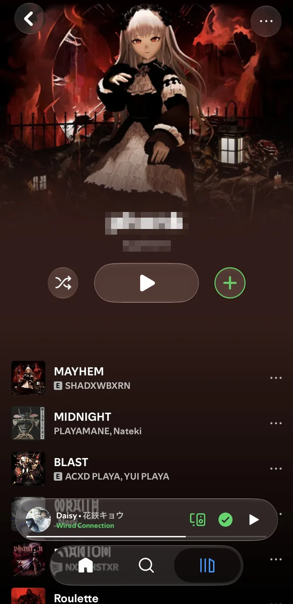
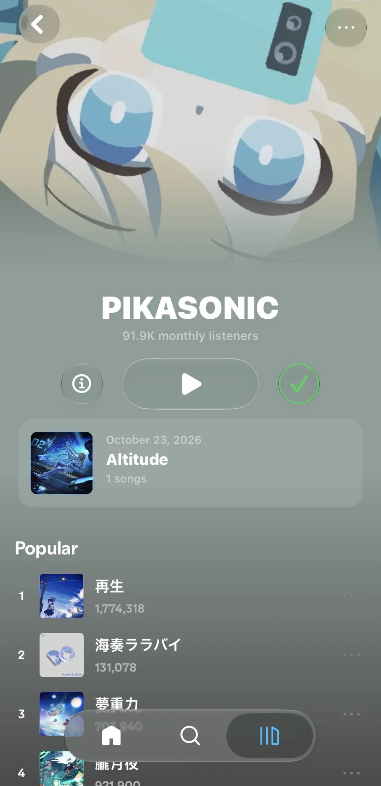
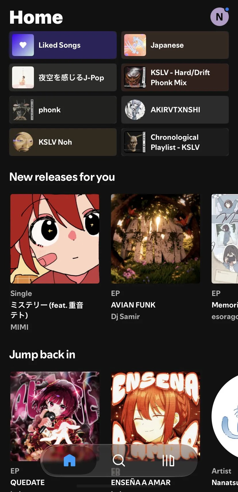

# EeveeSpotifyEvolved

word-by-word karaoke lyrics, an Apple Music–style layout, and a liquid-glass look for Spotify on iOS.

[Download](https://github.com/zbzxbg/EeveeSpotifyEvolved/releases) · [Features](#features) · [Install](#install) · [Build](docs/BUILDING.md) · [Credits](#credits)

  
  
  
  
  
  

> *Make EeveeSpotify Great Again* — said in jest, because everything below is a rebuild, not a reskin.

A derivative work based on [EeveeSpotifyReincarnated](https://github.com/SideloadLabs/EeveeSpotifyReincarnated) and [EeveeSpotify-ng](https://github.com/zbzxbg/EeveeSpotify-ng).

> [!NOTE]
> Tested on Spotify 9.1.88 on iOS 27.0.1; the liquid-glass look needs iOS 26+.

## Features

### Lyrics

- **12 sources** — Spicy Lyrics (needs your own client key), AMLL, PetitLyrics, NetEase, QQ Music, KuGou, Unison, Musixmatch, BiniLyrics, LRCLIB, Genius, plus an experimental Apple Music source.
- **Auto Select** — asks the sources in an order you choose and keeps the best answer: word-by-word beats line-by-line, which beats plain text; within the same tier it prefers the answer that also has the translation, official romanization or word-level romanization your settings ask for. A plain-text answer never ends the search.
- **Word-by-word karaoke** — real word timing, long-tone emphasis and interlude handling.

### Look and feel

- Apple Music–style album, playlist and artist pages.
- A single cover for playlists instead of the four-up mosaic.
- Liquid-glass tab bar and mini player.
- **Animated lock screen** (iOS 26+) — a short looping video in place of the still cover: Spotify's Canvas when the track has one, Apple Music's editorial video otherwise, and a loop rendered from the cover when neither has one. Settings → Animated lock screen.

Lyrics source details

- The default order is `AMLL → Spicy Lyrics → PetitLyrics → KuGou → NetEase → QQ Music → Unison → Musixmatch → BiniLyrics → LRCLIB → Genius`. Drag to reorder it under Settings → Lyrics → Lyrics Source Order.
- Spicy Lyrics is **skipped without being asked** when no client key is set (Settings → Lyrics), so a fresh install starts the chain at AMLL instead of waiting on a source that cannot answer.
- An answer that reports the track as **instrumental** ends the chain on the spot: no later source can carry lyrics for that track.
- The order only decides **who is asked first**; it never decides who wins. A word-by-word answer always beats a line-by-line one, which always beats plain text. Among answers with the same timing tier, the one that also carries a translation, official romanization, or word-level romanization (whichever switch asks for it) wins; a tie keeps the first arrival.
- With word-by-word lyrics on, Auto Select may keep asking until 4 seconds after the chain started — to upgrade a line-timed answer to a word-timed one, or to find one that also has the translation / romanization the current settings ask for. That cap exists so the lyrics card is not delayed past the point where it can still be built. It stops earlier when the best answer so far is line-timed and no source left in the chain can produce word timing.
- Auto Select is only offered when the now-playing style is **Immersive** or **Apple Music**. With Spotify's own layout the lyrics go straight into Spotify's card, so a single source is used instead.
- Word-timed sources: Spicy Lyrics, AMLL, PetitLyrics, NetEase (yrc), QQ Music (QRC), KuGou (KRC), Unison, Musixmatch (richsync), BiniLyrics, Apple Music TTML. LRCLIB is line-timed, Genius is plain text.
- The Apple Music official TTML source is under Settings → Experiments. It needs your own `media-user-token`, because Apple has no public lyrics API.

## Install

| Your setup | Download |
| --- | --- |
| Jailbroken | `.deb` (rootless and roothide variants) |
| TrollStore | `-patched.ipa` |
| Paid developer certificate (1 year) | `-patched.ipa` |
| SideStore / AltStore / Sideloadly / free or enterprise certificate | `.ipa` (no patch) |
| LiveContainer | `.ipa` (no patch) |

Get everything from [Releases](https://github.com/zbzxbg/EeveeSpotifyEvolved/releases). Building it yourself — from your own decrypted Spotify 9.1.88 IPA, with GitHub Actions or on a Mac — is covered in **[docs/BUILDING.md](docs/BUILDING.md)**.

> [!IMPORTANT]
> **Jailbroken users:** the `.deb` depends on `dev.theos.orion`. Add <https://repo.theos.dev/> to your package manager first, otherwise the install fails with an unmet dependency.

Why two IPAs? (pick one, not both)

- **`.ipa` (no patch)** — the plain build. Right for free and enterprise certificates, SideStore, AltStore and Sideloadly.
- **`-patched.ipa`** — the same build plus `zxPluginsInject.dylib`, a sideload shim that rebinds the keychain access group, neuters iCloud entitlements and stubs app groups. Pick it when a re-signed app misbehaves around login or the keychain. TrollStore doesn't re-sign, so the shim isn't strictly needed there.
- **LiveContainer** — it virtualises keychain, app groups and preferences itself, so the shim would conflict; use the unpatched `.ipa`.

Free profiles usually have no wildcard, so both builds ship without the Watch app and the native appex. How each file is produced: [docs/BUILDING.md](docs/BUILDING.md).

## Troubleshooting

**Now Playing misbehaves** (lyrics not showing, or a stale "coming soon" card): leave the Now Playing page and enter it again. This only applies if "Hide Spotify song Now Playing modules" is off.

**One song has no lyrics** — open Settings → Lyrics → Lyrics Source Order and check that a source which carries it is enabled. Auto Select asks the sources in order and skips any that return nothing, so one gap never blocks the others.

**A switch seems to do nothing** — force-quit Spotify once. Hooks are installed at launch, so a setting you just changed applies the next time the app starts.

## Requirements

- iOS 17.4 or later (iOS 26+ recommended for the liquid-glass look)
- Spotify 9.1.x — current public release: [`v2.0.0`](https://github.com/zbzxbg/EeveeSpotifyEvolved/releases)

| Spotify | How far it has been checked |
|---|---|
| **9.1.88** | Verified on iPhone 11 · iOS 27.0.1, certificate-signed (LCSign) and rootless deb |
| **9.1.94** | Static check only: every hook target, `@objc` method list and runtime UI identifier still resolves; the on-device look-and-feel has not been re-calibrated |
| other **9.1.x** | Untested, same code path |

## Credits

- [whoeevee](https://github.com/whoeevee) — the original EeveeSpotify project.
- [SideloadLabs](https://github.com/SideloadLabs/EeveeSpotifyReincarnated) — the Spicy Lyrics provider, logging and export.
- [LDDC](https://github.com/chenmozhijin/LDDC) and [pyqdes](https://github.com/naiyQAQ/pyqdes) — the key bytes and step order for the KuGou (KRC) and QQ Music (QRC) lyric decryption.
- [Taurus](https://github.com/samj-exe/taurus) — the provider list and the "ask in order, keep the finest timing" idea. Taurus is PolyForm Strict: **no code was copied**; see [docs/CREDITS.md](docs/CREDITS.md).

Full list of credits and licensing notes: [docs/CREDITS.md](docs/CREDITS.md).

## Legal

This repository contains derived technical identifiers and the scripts that regenerate them. It contains no Spotify binary, no decrypted `.ipa`, no audio or lyrics files, and no account credentials. Details, and how to request removal: [docs/LEGAL.md](docs/LEGAL.md).

## License

GPL-3.0, see [LICENSE](LICENSE). Not affiliated with, endorsed by, or connected to Spotify.
