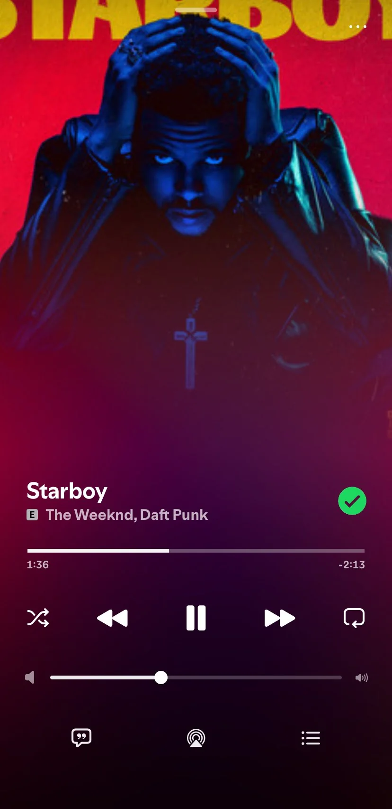
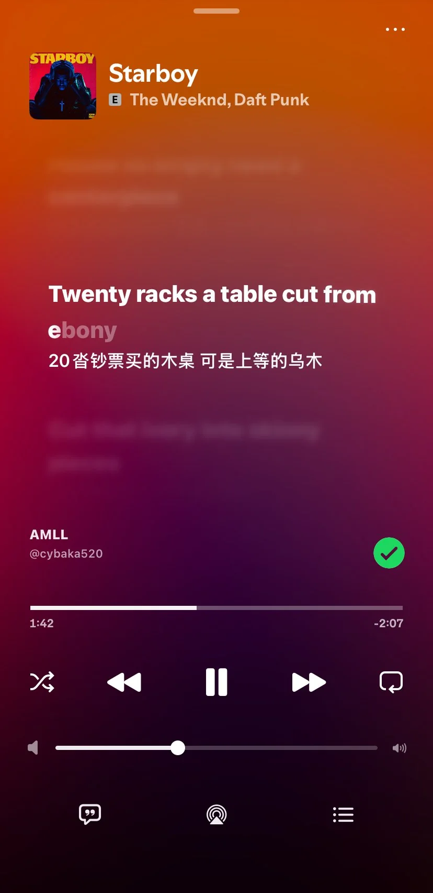
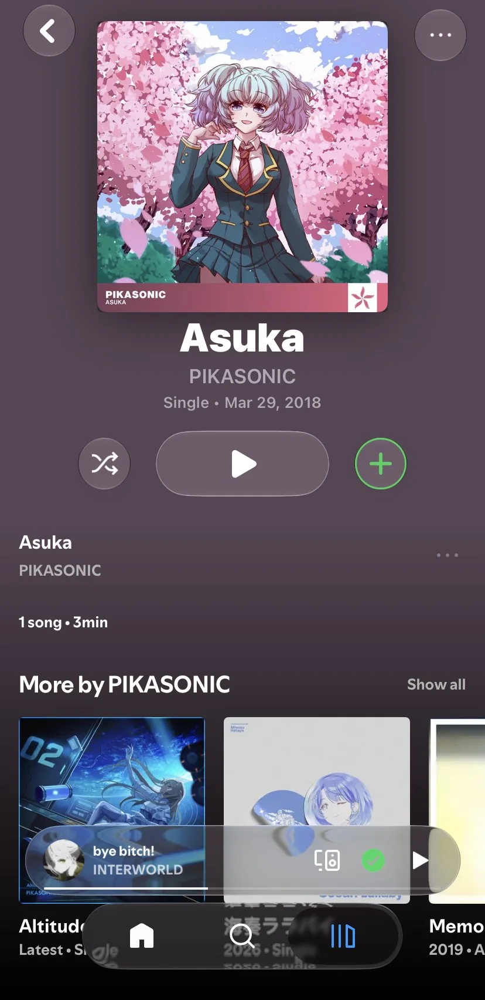
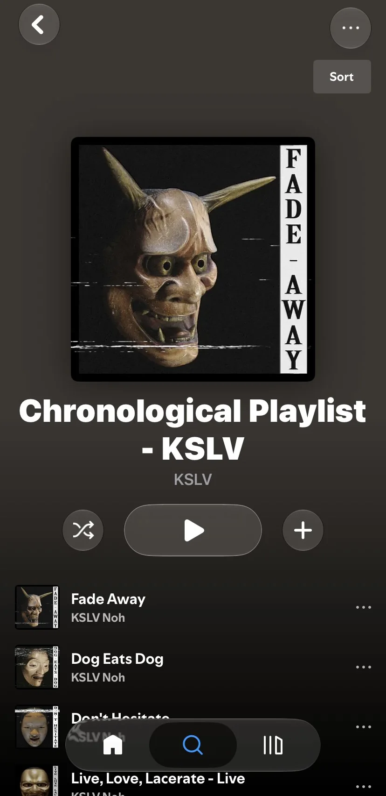
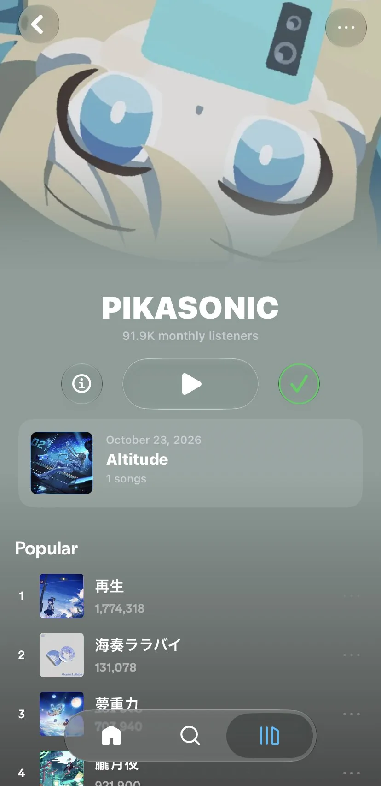
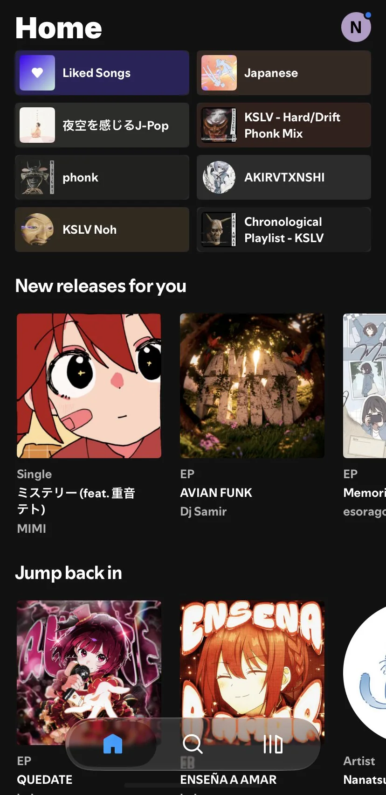

# Make EeveeSpotify Great Again

Word-by-word karaoke lyrics, an Apple Music–style layout, and a liquid-glass look for Spotify on iOS.

[Download](https://github.com/zbzxbg/EeveeSpotifyEvolved/releases) · [Features](#features) · [Install](#install) · [Build](docs/BUILDING.md) · [Credits](#credits)

  
  
  
  
  
  

A derivative work based on [EeveeSpotifyReincarnated](https://github.com/SideloadLabs/EeveeSpotifyReincarnated) and [EeveeSpotify-ng](https://github.com/zbzxbg/EeveeSpotify-ng).

> [!NOTE]
> Tested on Spotify 9.1.88, including with the Genius fallback enabled.

## Features

### Lyrics

- **12 sources** — Spicy Lyrics, AMLL, PetitLyrics, NetEase, QQ Music, KuGou, Unison, Musixmatch, BiniLyrics, LRCLIB, Genius, plus an experimental Apple Music source.
- **Auto Select** — asks the sources in an order you choose and keeps the finest timing: word-by-word beats line-by-line, which beats plain text. A plain-text answer never ends the search.
- **Word-by-word karaoke** — real word timing, long-tone emphasis and interlude handling.
- **Romanization** — Chinese, Korean and Japanese can be shown or hidden independently.

### Look and feel

- Apple Music–style album, playlist and artist pages.
- A single cover for playlists instead of the four-up mosaic.
- Liquid-glass tab bar and mini player.

Lyrics source details

- The default order is `AMLL → Spicy Lyrics → PetitLyrics → NetEase → QQ Music → KuGou → Unison → Musixmatch → BiniLyrics → LRCLIB → Genius`. Drag to reorder it under Settings → Lyrics → Lyrics Source Order.
- The order only decides **who is asked first**; it never decides who wins. A word-by-word answer always beats a line-by-line one, which always beats plain text.
- With word-by-word lyrics on, Auto Select keeps looking for a word-timed answer for up to 4 seconds after the first line-timed one. That cap exists so the lyrics card is not delayed past the point where it can still be built.
- Auto Select is only offered when the now-playing style is **Immersive** or **Apple Music**. With Spotify's own layout the lyrics go straight into Spotify's card, so a single source is used instead.
- Word-timed sources: Spicy Lyrics, AMLL, PetitLyrics, NetEase (yrc), QQ Music (QRC), KuGou (KRC), Unison, Musixmatch (richsync), BiniLyrics, Apple Music TTML. LRCLIB is line-timed, Genius is plain text.
- The Apple Music official TTML source is under Settings → Experiments. It needs your own `media-user-token`, because Apple has no public lyrics API.

## Install

| Your setup | Download |
| --- | --- |
| Jailbroken | the `.deb` (rootless and roothide variants) |
| TrollStore | `-patched.ipa` |
| Paid developer certificate (1 year) | `-patched.ipa` |
| SideStore / AltStore / Sideloadly / free or enterprise certificate | `.ipa` (no patch) |
| LiveContainer | `.ipa` (no patch) |

Get everything from [Releases](https://github.com/zbzxbg/EeveeSpotifyEvolved/releases). Building it yourself — from your own decrypted Spotify 9.1.88 IPA, with GitHub Actions or on a Mac — is covered in **[docs/BUILDING.md](docs/BUILDING.md)**.

> [!IMPORTANT]
> **Jailbroken users:** the `.deb` depends on `dev.theos.orion`. Add <https://repo.theos.dev/> to your package manager first, otherwise the install fails with an unmet dependency.

Why different files? (sideload shim, Orion runtime)

The patched IPA injects `zxPluginsInject.dylib`, a sideload shim (keychain access-group rebind, iCloud entitlement neutering, app-group `group.*` stubs). It fixes things that break when an app is re-signed by a different team, so if a sideloaded build misbehaves around login or keychain, try the patched one.

Free profiles usually have no wildcard, so the Watch app and native appex have to be stripped (`Tools/strip-ipa.sh`). LiveContainer virtualises keychain, app groups and preferences itself, and the shim on top would conflict. TrollStore doesn't re-sign, so entitlements stay intact.

The IPA pipelines bundle `Orion.framework` into the app, since a sideloaded app has no package manager to resolve dependencies. How each of these lands in the build: [docs/BUILDING.md](docs/BUILDING.md).

## Troubleshooting

**Now Playing misbehaves** (lyrics not showing, or a stale "coming soon" card): leave the Now Playing page and enter it again. This only applies if "Hide Spotify song Now Playing modules" is off.

**One song has no lyrics** — open Settings → Lyrics → Lyrics Source Order and check that a source which carries it is enabled. Auto Select asks the sources in order and skips any that return nothing, so one gap never blocks the others.

**A switch seems to do nothing** — force-quit Spotify once. Hooks are installed at launch, so a setting you just changed applies the next time the app starts.

## Requirements

- iOS 17.4 or later (iOS 26+ recommended for the liquid-glass look)
- Spotify 9.1.88 (current public release: [`v1.0.0`](https://github.com/zbzxbg/EeveeSpotifyEvolved/releases))

Verified on: iPhone 11 · Spotify 9.1.88 · iOS 27.0.1 · certificate-signed · LCSign · rootless deb.

## Credits

- [whoeevee](https://github.com/whoeevee) — the original EeveeSpotify project.
- [SideloadLabs](https://github.com/SideloadLabs/EeveeSpotifyReincarnated) — the Spicy Lyrics provider, logging and export.
- [LDDC](https://github.com/chenmozhijin/LDDC) and [pyqdes](https://github.com/naiyQAQ/pyqdes) — the key bytes and step order for the KuGou (KRC) and QQ Music (QRC) lyric decryption.
- [Taurus](https://github.com/samj-exe/taurus) — the provider list and the "ask in order, keep the finest timing" idea. Taurus is PolyForm Strict: **no code was copied**; see [docs/CREDITS.md](docs/CREDITS.md).

Full list of credits and licensing notes: [docs/CREDITS.md](docs/CREDITS.md).

## Legal

This repository contains derived technical identifiers and the scripts that regenerate them. It contains no Spotify binary, no decrypted `.ipa`, no audio or lyrics files, and no account credentials. Details, and how to request removal: [docs/LEGAL.md](docs/LEGAL.md).

## License

GPL-3.0, see [LICENSE](LICENSE). Not affiliated with, endorsed by, or connected to Spotify.
